# LaRMo: Language-Rewarded Motion

### 자연어 기반 보상 설계를 활용한 휴머노이드 캐릭터 모션 제어

**말로 시키면, 물리 시뮬레이션 속 휴머노이드가 그대로 움직인다.**

아주대학교 소프트웨어학과 자기주도연구 (2026-2) | 이종학, 지도교수 유리

<p align="center">
  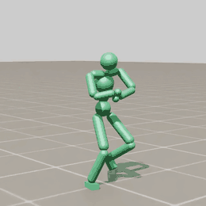 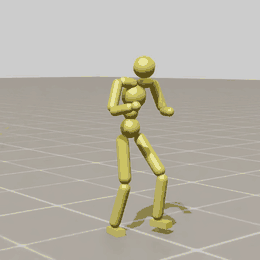
  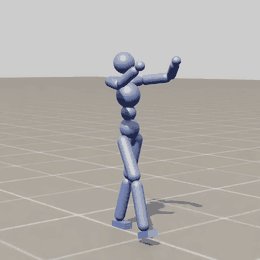 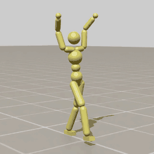
</p>
<p align="center"><sub>"고릴라처럼 가슴을 두드리며 걸어", "티라노사우루스처럼 걸어", "특공대원처럼 총을 겨눈 자세로 걸어", "두 팔을 머리 위로 들고 걸어"로 각각 학습한 정책</sub></p>

LaRMo는 자연어 명령을 받으면 LLM이 스타일 파라미터를 정하고, 고정한 보상 수식이 그 값으로 참조 모션의 목표를 바꾼 뒤, 명령마다 강화학습 정책을 학습합니다.
정책은 Isaac Lab 물리 시뮬레이션 안에서 관절 토크로 움직이므로, 발이 뜨거나 미끄러지지 않고 "상체를 40도 숙여" 같은 수치나 "왼손만" 같은 한쪽 지시도 보상의 목표로 그대로 들어갑니다.
참조 모션(MimicKit의 걷기, 달리기, 점프, 앞차기, 돌려차기)은 한 번도 고치지 않았습니다.

<p align="center">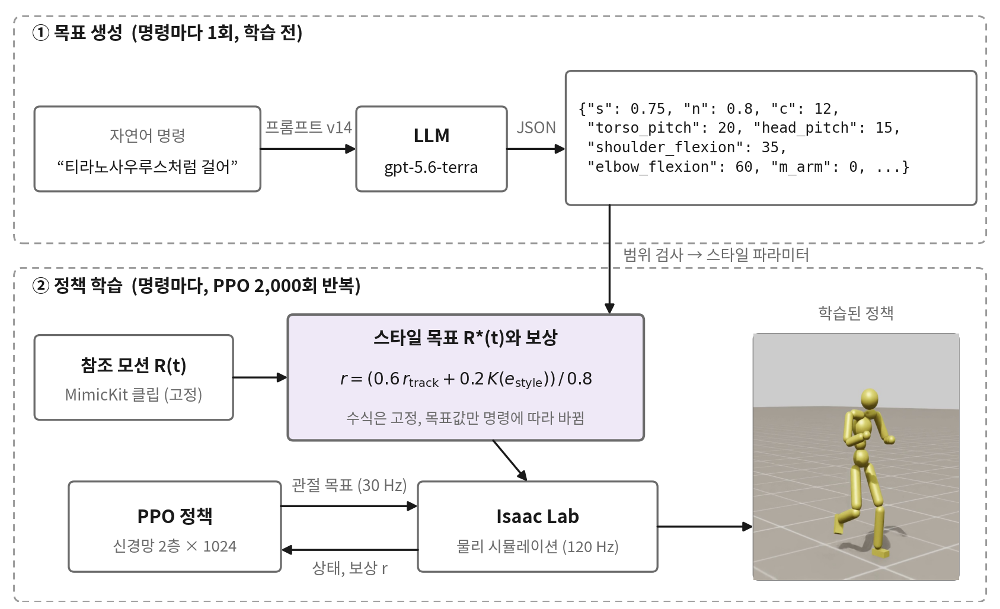</p>

## 결과 영상

### 스타일 명령

평가용 명령 25개(동물, 인물과 캐릭터, 몸의 특징, 기분과 태도) 가운데 여덟 개입니다. 정책마다 따로 촬영하였습니다.

| 고릴라처럼 가슴을 두드리며 | 티라노사우루스처럼 | 수탉처럼 | 고양이처럼 조심스럽게 |
| :---: | :---: | :---: | :---: |
|  |  | 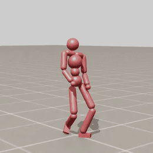 | 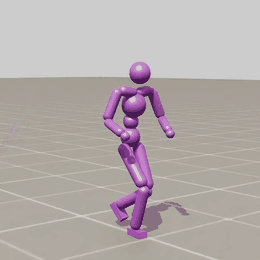 |
| **패션모델처럼 뽐내며** | **특공대원처럼 총을 겨눈 자세로** | **팔짱을 끼고** | **두 팔을 머리 위로 들고** |
| 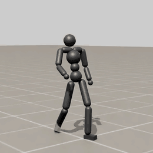 |  | 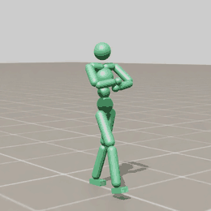 |  |

### 같은 명령, 네 방법

같은 명령을 공개 text-to-motion 모델 세 개(MoMask, T2M-GPT, MDM)에도 넣고, 그 출력을 본 연구의 캐릭터로 옮겨 같은 카메라로 찍었습니다(옆 카메라).

| 명령 | LaRMo | MoMask | T2M-GPT | MDM |
| :--- | :---: | :---: | :---: | :---: |
| 상체를 40도 앞으로 숙이고 걸어 | 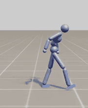 | 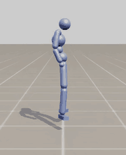 | 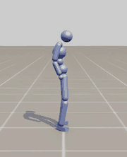 | 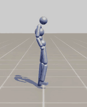 |
| 왼손을 번쩍 들고 걸어 | 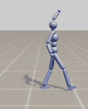 | 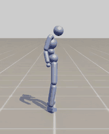 | 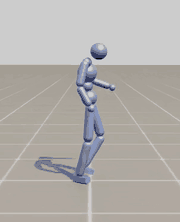 | 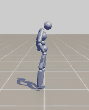 |

### 연속 동작

LLM이 동작의 순서와 길이를 출력하면, 참조 클립을 0.5초씩 섞어 이은 하나의 참조 모션으로 학습합니다.

| 뛰어가다가 앞으로 크게 점프해 | 걷다가 돌려차기 해 |
| :---: | :---: |
| 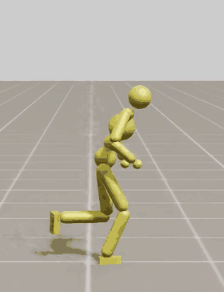 | 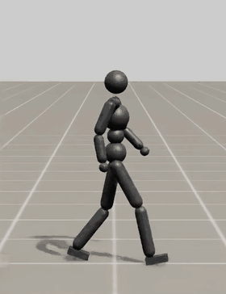 |

### 한쪽 동작

<p align="center">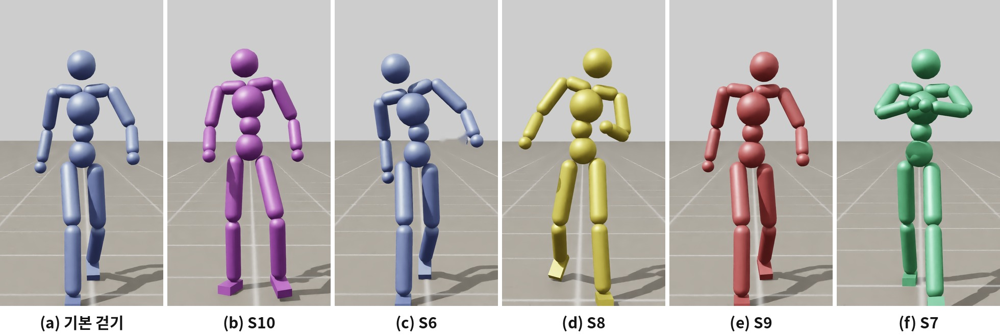</p>
<p align="center"><sub>정면에서 본 모습(캐릭터의 왼쪽이 그림의 오른쪽). 왼쪽부터 기본 걷기, 왼손을 번쩍 들고, 몸을 오른쪽으로 기울이고, 무거운 가방을 왼쪽 어깨에 메고, 고개를 왼쪽으로 갸웃하고, 다친 왼팔을 감싸 쥐고(실패)</sub></p>

## 결과 요약

사전에 정의한 평가 명령 60개(스타일 25, 수치 13, 한쪽 동작 10, 발끝 걷기 4, 연속 동작 8)로 측정하였습니다.
LaRMo는 명령마다 학습한 정책 하나를, 비교 모델은 명령마다 출력 3개를 HumanML3D 관절 그대로 같은 방법으로 측정하였습니다.

| 평가 항목 | LaRMo | MoMask | T2M-GPT | MDM |
| :--- | :---: | :---: | :---: | :---: |
| 지시값 대비 상대 오차 (중앙값, 낮을수록 좋음) | **5%** | 95% | 78% | 80% |
| 100STYLE 스타일 유사도 (높을수록 좋음) | **0.46** | 0.13 | 0.28 | 0.23 |
| 한쪽 동작 명령 통과 | **9/10 (90%)** | 10/30 (33%) | 16/30 (53%) | 10/30 (33%) |
| 연속 동작 순서 판정 통과 | **5/8 (63%)** | 7/24 (29%) | 1/24 (4%) | 6/24 (25%) |
| 지면 부유 (cm, 낮을수록 좋음) | **0.00** | 5.49 | 1.82 | 3.71 |
| 지지발 미끄러짐 (cm, 낮을수록 좋음) | **0.05** | 1.53 | 2.27 | 1.79 |

지면 부유는 걷는 동안 발이 바닥에서 뜬 평균 높이, 지지발 미끄러짐은 디딤마다 지지발이 미끄러진 거리의 중앙값이며, 둘 다 걷기 명령 48개(스타일, 수치, 한쪽 동작) 기준입니다.

- 걷기 정책 52개 모두 캐릭터 4개를 30초씩 기록하는 동안 한 번도 넘어지지 않았습니다.
- 스타일 유사도는 동물, 인물, 몸의 특징, 기분의 네 종류 모두에서 가장 높았고, 목표 스타일이 99개 가운데 1위인 명령이 6개였습니다.
- 한계도 있습니다. 명령마다 정책을 새로 학습하므로 한 명령에 30~40분(RTX 5070)이 걸리고, 손이나 발을 특정 위치에 닿게 하는 동작(전화 받기, 지팡이)은 표현하기 어렵습니다. 스타일 명령 25개 가운데 군인 행진, 펭귄 등 9개는 비교 모델의 유사도가 더 높았습니다.

## 방법

### 고정한 보상 함수

$$
r = \frac{0.6\, r_{\mathrm{track}} + 0.2\, K(e_{\mathrm{style}})}{0.8}, \qquad
e_{\mathrm{style}} = \frac{\sum_j w_j\, \theta_j^2}{\sum_j w_j}, \qquad
K(e) = \tfrac{1}{3}\left[e^{-20e} + e^{-\sqrt{20k}\,e} + e^{-ke}\right], \quad k = \frac{1}{\max\left(g,\ (3^\circ)^2\right)}
$$

- $r_{\mathrm{track}}$: MimicKit의 DeepMimic 추적 보상. 추적 목표를 스타일 목표로 바꾸어 씁니다.
- $e_{\mathrm{style}}$: 스타일이 목표를 바꾼 관절이 움직이는 강체 $j$에 대해, 캐릭터의 강체와 목표 강체 사이의 각도 $\theta_j$(라디안)의 제곱을 DeepMimic 관절 가중치 $w_j$로 가중 평균한 값. 진행 방향 기준으로 비교하므로 관찰자 시점의 자세를 직접 맞춥니다.
- $g$: 스타일을 무시하고 원래 참조 모션을 따를 때의 $e_{\mathrm{style}}$(요청한 변화의 크기). 수식은 모든 명령에 같고, 목표값만 명령에 따라 바뀝니다.

### 스타일 파라미터

LLM(gpt-5.6-terra, 프롬프트 v14)이 JSON으로 출력하고, Python이 범위를 검사한 뒤 보상 설정으로 바꿉니다.

| 종류 | 파라미터 |
| :--- | :--- |
| 공간과 시간 배율 | `s` 보폭, `n` 보행 박자 (걷는 속도 = 1.26 × s × n m/s) |
| 진폭 배율 | `m_arm`, `m_torso`, `m_knee`, `m_elbow` |
| 자세 오프셋 | 상체와 고개의 기울기, 어깨와 팔꿈치 각도, 다리 벌림, 발끝 각도 |
| 무릎, 발, 경로 | 무릎 굽힘 `c`, 위아래 출렁임 `bounce`, 발끝 세우기 `foot_pitch`, 갈지자 길 `weave` |
| 한쪽 값 | `right_`, `left_` 접두어로 한쪽 팔다리에만 다른 값 |
| 연속 동작 | `{"sequence": [{"action": "run", "seconds": 2.4}, {"action": "jump", "seconds": 1.77}]}` |

### 학습과 평가

- 학습: Isaac Lab 2.3.2와 MimicKit, PPO 2,000회 반복, 환경 1,024개 (MimicKit의 DeepMimic 휴머노이드 기본 설정)
- 평가 명령 세트는 `experiments/style_llm/test_commands_*.json`에 있습니다. 프롬프트는 개발용 6세트로만 고쳤고, 평가용 7~10세트는 최종 실행 전에 미리 정의하였습니다.
- 스타일 지표는 100STYLE 데이터셋의 스타일과 비교한 특징 변화의 코사인 유사도입니다(`experiments/style_eval`).

## 저장소 구성

```text
MimicKit/                 MimicKit 소스 (Apache-2.0). envs/text_reward_env.py를 더하고 세 파일을 고쳤습니다 (THIRD_PARTY.md)
experiments/
  style_llm/              LLM 파서와 프롬프트 v5~v14, 명령 세트, 모델별 응답과 결과
  style_walk/             학습 실행(run_style_walk.py), 최종 실행(final_runs.sh), 촬영(film.py), 실험 기록
  style_eval/             100STYLE 지표, 정책 기록(record_policies.py), 한쪽 동작 판정(side_check.py)
  chain/                  연속 동작 클립 합성(compose_chain.py)과 순서 판정(chain_check.py)
  t2m_compare/            MoMask, T2M-GPT, MDM 출력 생성과 측정, 사람 평가 도구
  train_eval/, parser_eval/, spinkick/   중간보고서 이전의 실험
docs/                     README의 영상과 그림 (make_media.py)
train_from_text.py, motion_parser.py, play_motion.py   초기 파이프라인 (Qwen 파서로 방향과 속도만 지정)
```

## 실행 방법

필요한 것: Isaac Lab 2.3.2 가상환경(스크립트 첫 줄이 `/home/jong/isaaclab/.venv/bin/python`을 가리키므로 환경에 맞게 바꿉니다), MimicKit 모션 데이터([MimicKit 설치 안내](MimicKit/README.md)), 저장소 루트의 `.env`에 `OPENAI_API_KEY`. 100STYLE 데이터와 비교 모델은 포함하지 않습니다.

```bash
# 명령 하나를 스타일 파라미터로
./experiments/style_llm/style_parser.py "펭귄처럼 걸어" --prompt v14 --model api:gpt-5.6-terra

# 명령 세트(예: 7세트)의 응답을 만들고 2,000회씩 학습
./experiments/style_llm/style_parser.py --test 7 --prompt v14 --model api:gpt-5.6-terra
./experiments/style_walk/run_style_walk.py --resume experiments/style_llm/<시각>_v14_set7_gpt-5.6-terra --iters 2000

# 최종 평가 전체: 응답, 학습, 기록, 측정, 촬영
SETS="8 7 9 10" nohup bash experiments/style_walk/final_runs.sh v14 > /dev/null 2>&1 &

# 학습한 정책 촬영 (옆, 정면, 비스듬한 시점)
./experiments/style_walk/film.py experiments/style_walk/<실험 폴더> --view quarter
```

## 출처

- [MimicKit](https://github.com/xbpeng/MimicKit) (Apache-2.0), [Isaac Lab](https://github.com/isaac-sim/IsaacLab), [DeepMimic](https://arxiv.org/abs/1804.02717)
- [100STYLE](https://www.ianxmason.com/100style/) (스타일 지표의 기준, 데이터는 포함하지 않음)
- 비교 모델: [MoMask](https://github.com/EricGuo5513/momask-codes), [T2M-GPT](https://github.com/Mael-zys/T2M-GPT), [MDM](https://github.com/GuyTevet/motion-diffusion-model)
